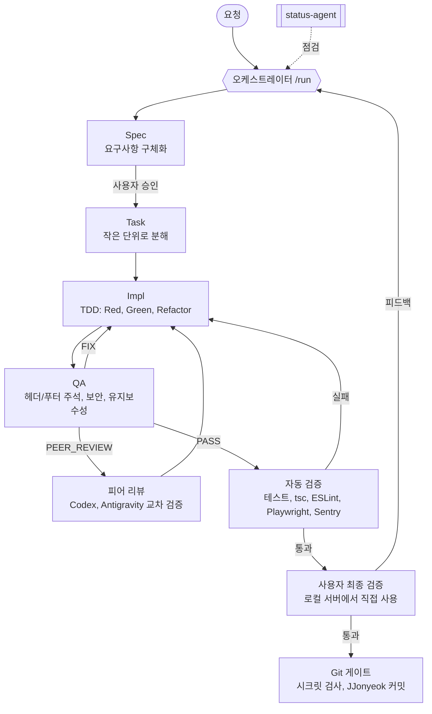

# Claude Harness

Claude Code에서 쓰는 **Spec → Task → Impl → QA** 작업 하네스입니다.

요구사항이 애매한 채로 개발을 시작하지 않도록 단계를 고정합니다. 메인 세션이 오케스트레이터가 되어 서브에이전트에게 일을 나누고, 테스트 주도 개발과 자동 검증, 외부 AI 교차 리뷰를 거친 뒤 사람이 직접 써 보고 나서야 커밋합니다.



## 특징

- **단계 고정**: 요청이 들어오면 먼저 어느 단계에 해당하는지 판별하고 밝힌 뒤 진행합니다.
- **오케스트레이터와 상태 파일**: `/run` 하나로 Spec부터 커밋 직전까지 이끌고, 세션이 끊겨도 `docs/STATE.md`를 보고 이어서 진행합니다.
- **테스트 먼저**: Impl 에이전트는 실패하는 테스트를 먼저 쓰고 확인한 뒤에만 구현합니다.
- **병렬과 순차**: 단순하지만 오래 걸리는 작업은 최대 3개까지 동시에, 복잡하거나 공유 파일을 건드리는 작업은 하나씩 처리합니다.
- **교차 피어 리뷰**: Computer Use로 Codex와 Antigravity를 직접 띄워 리뷰를 받고, 두 결과를 대조합니다. 리뷰어는 의견만 내고 파일은 건드리지 못합니다.
- **상태 점검**: `status-agent`가 에이전트별 진행 상황과 어긋난 곳을 읽기 전용으로 점검합니다.
- **말로만 정하지 않은 Git 규칙**: 시크릿 업로드, 모델명이 들어간 커밋 메시지, 다른 작성자 이름을 훅이 실제로 막습니다.

## 빠른 시작

```bash
git clone https://github.com/JJonyeok2/Claude_Harness.git
bash Claude_Harness/scripts/install.sh /path/to/my-project
cd /path/to/my-project
claude
```

Claude Code 안에서:

```
/run 로그인 화면이랑 회원가입 기능 만들고 싶어
```

자세한 설치와 첫 사이클 예시는 [시작하기](guide/getting-started.md)에 있습니다.

## 명령어

| 명령 | 하는 일 |
|---|---|
| `/run <요청>` | 오케스트레이터. 단계 판별 후 끝까지 진행. 인자 없이 치면 멈춘 곳부터 이어서 |
| `/status` | 에이전트별 진행 중, 완료, 중단, 멈춤 의심 점검 |
| `/spec <요청>` | Spec 작성, 갱신 |
| `/task [기능 ID]` | Spec을 Task로 분해, 병렬/순차 분류 |
| `/impl <번호>` | 한 Task를 TDD로 구현하고 바로 QA |
| `/qa <번호>` | QA만 다시 실행 |
| `/peer-review <번호> [codex\|antigravity\|both]` | Computer Use로 교차 리뷰 |
| `/verify` | 자동 검증 후 로컬 서버 실행 |
| `/ship <요지>` | 시크릿 검사 후 커밋 |

전체 설명은 [명령어 레퍼런스](guide/commands.md)를 보세요.

## 문서

| 문서 | 내용 |
|---|---|
| [시작하기](guide/getting-started.md) | 요구 사항, 설치, 첫 사이클 따라 하기 |
| [작업 흐름](guide/workflow.md) | 단계별 상세, 상태 흐름, 단계 판별표, 산출물 |
| [에이전트](guide/agents.md) | 오케스트레이터와 서브에이전트 6개의 역할, 도구, 입출력 |
| [명령어 레퍼런스](guide/commands.md) | 슬래시 명령 9개 사용법과 예시 |
| [병렬과 순차 실행](guide/parallel-execution.md) | 분류 기준, 그룹 실행, worktree 병합 |
| [피어 리뷰](guide/peer-review.md) | Computer Use 교차 검증 절차, 안전장치, 대체 경로 |
| [Git 안전장치](guide/git-safety.md) | 훅 구조, 시크릿 검사 패턴, 커밋 규칙 |
| [내 프로젝트에 맞추기](guide/customizing.md) | 작성자 이름, 검증 명령, 패턴, 한도 바꾸기 |
| [문제 해결](guide/troubleshooting.md) | 자주 막히는 상황과 해결 방법 |
| [변경 이력](CHANGELOG.md) | 버전별 변경 사항 |

## 저장소 구조

```
CLAUDE.md                 하네스 규칙 (설치하면 대상 프로젝트로 복사됨)
.claude/
  settings.json           .env 읽기 금지, Git 가드 훅
  agents/                 spec, task, impl, qa, verify, status
  commands/               run, status, spec, task, impl, qa, peer-review, verify, ship
.githooks/                pre-commit, commit-msg
scripts/                  install.sh, check-secrets.sh, claude-git-guard.sh
docs/                     대상 프로젝트로 복사되는 템플릿과 규칙
  templates/              SPEC, TASK, QA_REPORT, PEER_REVIEW_REQUEST, STATE
  conventions/            헤더/푸터 주석 규칙
guide/                    이 저장소의 설명서 (복사되지 않음)
gitignore.snippet         설치 시 대상 .gitignore에 추가되는 항목
```

## 요구 사항

- Claude Code
- Git, Bash, Python 3 또는 Node.js (훅에서 JSON 파싱용)
- 선택: Playwright, ESLint, TypeScript (자동 검증), `gitleaks` (시크릿 검사 보강), Sentry MCP 또는 `sentry-cli`, Codex 앱 또는 CLI, Antigravity (피어 리뷰)

## 라이선스

[MIT](LICENSE)
