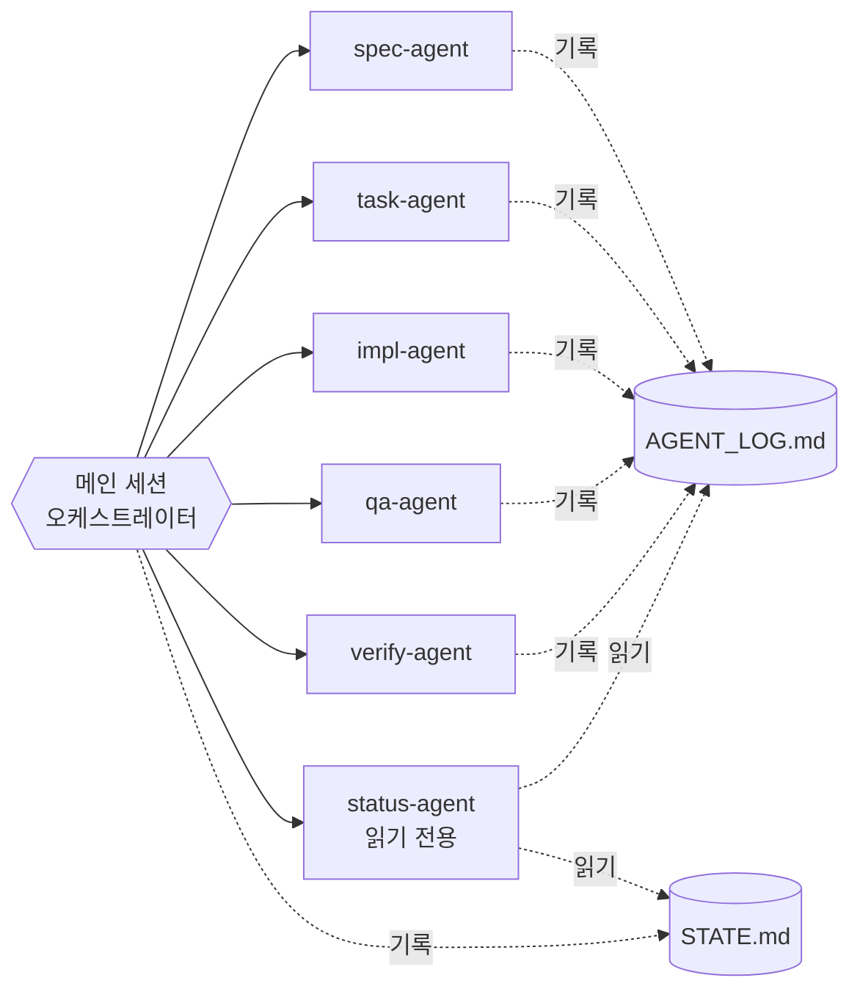

# 에이전트

## 구조



### 왜 오케스트레이터는 서브에이전트가 아닌가

Claude Code의 서브에이전트는 다른 서브에이전트를 부를 수 없습니다. 오케스트레이터를 서브에이전트로 만들면 Spec, Task 같은 에이전트를 호출하지 못하므로, 메인 세션이 `/run` 절차를 따라 오케스트레이터 역할을 맡습니다. Computer Use도 메인 세션에서만 쓰기 때문에 피어 리뷰 역시 메인 세션이 직접 진행합니다.

## 오케스트레이터 (메인 세션)

| 항목 | 내용 |
|---|---|
| 정의 위치 | `.claude/commands/run.md`, `CLAUDE.md` |
| 하는 일 | 단계 판별, 서브에이전트 배치, 병렬/순차 스케줄링, 회귀 결정, 상태 기록, 피어 리뷰 직접 진행 |
| 하지 않는 일 | 코드와 문서를 직접 작성 |
| 기록 | `docs/STATE.md` |

## 작업 에이전트

| 에이전트 | 도구 | 입력 | 출력 | 코드 수정 |
|---|---|---|---|---|
| `spec-agent` | Read, Write, Edit, Glob, Grep, Bash(시각, 목록 확인만) | 요청 원문, 기존 SPEC | `SPEC.md`, 질문 목록, 승인 요청 | 안 함 |
| `task-agent` | Read, Write, Edit, Glob, Grep, Bash(시각, 목록 확인만) | 승인된 SPEC, 대상 기능 ID | Task 파일들, `INDEX.md` | 안 함 |
| `impl-agent` | Read, Write, Edit, Glob, Grep, Bash | Task 경로, 필요한 Spec 섹션, 테스트 명령 | 테스트와 구현, Red/Green 로그 요약 | 함 (Task 범위 안에서만) |
| `qa-agent` | Read, Write, Edit, Glob, Grep, Bash | Task 번호, 바뀐 파일 | 헤더/푸터 주석, QA 보고서, 판정 | 주석만 |
| `verify-agent` | Read, Glob, Grep, Bash | 검증 명령 목록 | 도구별 결과, 실패 분류, 확인 시나리오 | 안 함 |

모든 작업 에이전트는 시작, 완료, 중단 시점에 `docs/status/AGENT_LOG.md`에 한 줄씩 남깁니다.

```
| 2026-11-02 22:01 | impl-agent | TASK-03 | 완료 | 테스트 6개 통과 |
```

## 점검 에이전트

### `status-agent`

| 항목 | 내용 |
|---|---|
| 도구 | Read, Glob, Grep, Bash(읽기 명령만) |
| 부르는 법 | `/status`, 그리고 오케스트레이터가 `/run` 재개 시와 Task 3개마다 자동 호출 |
| 읽는 것 | `AGENT_LOG.md`, `STATE.md`, Task, QA, 리뷰, 피드백 파일, `git status` |

판단 기준:

| 상태 | 조건 |
|---|---|
| 진행 중 | `시작`만 있고 `완료`나 `중단`이 없음 |
| 멈춤 의심 | 진행 중인데 30분 넘게 기록 없음, 또는 FIX 2회 초과 |
| 중단 | `중단` 기록이 있음 |
| 완료 | 마지막 기록이 `완료` |
| 대기 | `STATE.md`의 "대기 중"에 항목이 있음 |

추가로 잡아내는 것:
- STATE는 QA인데 QA 보고서가 없음
- 완료된 Task 파일에 헤더/푸터 주석이 없음
- 피어 리뷰 결과 칸이 비어 있음
- 같은 병렬 그룹의 Task가 같은 파일을 바꿈
- 순차 Task가 다른 Task와 동시에 시작됨
- `.env` 계열 파일이 스테이징됨

보고 예시:

```
현재 단계: QA (TASK-03)   대기 중: 없음

| 에이전트 | 대상 | 상태 | 마지막 기록 | 비고 |
|---|---|---|---|---|
| impl-agent | TASK-03 | 완료 | 11-02 22:01 | 테스트 6개 통과 |
| qa-agent | TASK-03 | 진행 중 | 11-02 22:05 | |

Task 진행: 2/5 완료, 1 진행 중, 2 대기
병렬 그룹: G1 (TASK-02 완료, TASK-03 진행 중) / 파일 겹침 없음
문제: 없음
다음 명령: /run
```
