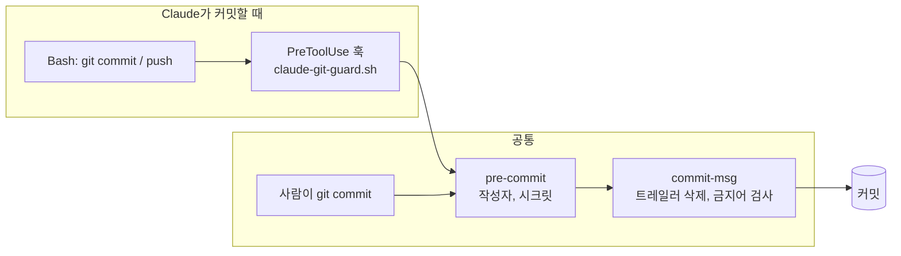

# Git 안전장치

규칙을 `CLAUDE.md`에 적어 두는 것만으로는 지켜진다는 보장이 없어서, 실제로 막는 장치를 세 겹으로 둡니다.

## 구조



| 장치 | 파일 | 언제 | 하는 일 |
|---|---|---|---|
| 읽기 차단 | `.claude/settings.json` | 항상 | `.env`, `.env.*` 파일을 Claude가 읽지 못하게 막음 |
| 공동저자 끄기 | `.claude/settings.json` | Claude가 커밋할 때 | `includeCoAuthoredBy: false` |
| Git 가드 훅 | `scripts/claude-git-guard.sh` | Claude가 `git commit`, `git push`를 실행하기 직전 | 명령줄 메시지의 금지어, 작성자 이름, 시크릿 검사. 실패하면 명령 자체를 실행하지 않음 |
| pre-commit | `.githooks/pre-commit` | 모든 커밋 | 작성자 이름, 스테이징된 시크릿 검사 |
| commit-msg | `.githooks/commit-msg` | 모든 커밋 | `Co-Authored-By`, `Claude-Session`, "Generated with" 줄 자동 삭제 후, 모델명이 남아 있으면 차단 |

## 커밋 규칙

- 작성자 이름: `JJonyeok`
- 메시지 형식: `<type>: <한국어 요약>` (`feat`, `fix`, `refactor`, `test`, `docs`, `chore`)
- 메시지 금지어: `claude`, `anthropic`, `opus`, `sonnet`, `haiku`, `gpt-숫자`, `codex`, `gemini` (대소문자 무관)
  - 예외: 파일 이름 `CLAUDE.md`
- 커밋과 푸시는 사용자가 요청할 때만

## 시크릿 검사

`scripts/check-secrets.sh`

| 옵션 | 대상 | 쓰이는 곳 |
|---|---|---|
| `--staged` | 스테이징된 변경 | 커밋 직전 |
| `--outgoing` | 아직 원격에 없는 커밋 | 푸시 직전 |
| `--all` | 추적 중인 모든 파일 | 수동 점검 |

### 파일 이름으로 막는 것

`.env`, `.env.*` (단 `.env.example`, `.env.sample`, `.env.template` 허용), `*.pem`, `*.key`, `*.p12`, `*.pfx`, `id_rsa`, `id_ed25519`, `credentials.json`, `service-account*.json`

### 내용 패턴으로 막는 것

| 종류 | 패턴 예 |
|---|---|
| AWS Access Key | `AKIA` + 16자 |
| Anthropic | `sk-ant-...` |
| OpenAI | `sk-...`, `sk-proj-...` |
| GitHub | `ghp_`, `gho_`, `ghu_`, `ghs_`, `ghr_` |
| Slack | `xoxb-`, `xoxp-` 등 |
| Google API | `AIza` + 35자 |
| 개인 키 | `-----BEGIN ... PRIVATE KEY-----` |
| Sentry 인증 토큰 | `sntrys_...` |
| 일반 | `api_key`, `secret`, `token`, `password` 뒤에 12자 넘는 따옴표 문자열 |

`gitleaks`가 설치돼 있으면 함께 실행합니다.

## 동작 확인 결과

설치 직후 임시 저장소에서 확인한 결과입니다.

| 시나리오 | 결과 |
|---|---|
| `.env`와 AWS 키가 든 파일 커밋 | 차단, 두 위치 모두 보고 |
| 깨끗한 파일 + `Co-Authored-By`, `Claude-Session` 트레일러 | 통과, 트레일러 자동 삭제, 작성자 `JJonyeok` |
| 메시지 본문에 `opus` | 차단 |
| 메시지에 `CLAUDE.md` | 통과 (예외) |
| 가드 훅: 입력 JSON 경로에 `.claude`가 있지만 명령은 깨끗 | 통과 (오탐 없음) |
| 가드 훅: 메시지에 `Claude` | 차단 (종료 코드 2) |
| 가드 훅: `npm test` 같은 다른 명령 | 그냥 통과 |
| 가드 훅: 작성자 이름이 다름 | 차단 |

## 직접 점검하기

```bash
bash scripts/check-secrets.sh --all
git config user.name
git config core.hooksPath
```
