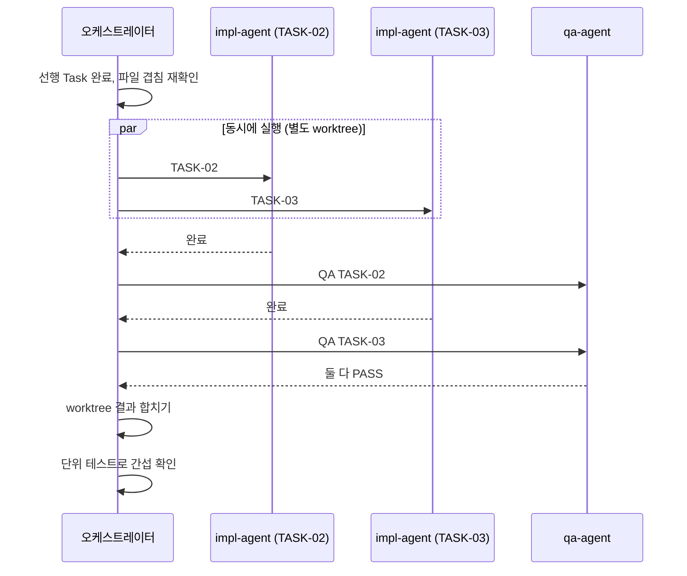

# 병렬과 순차 실행

단순하지만 오래 걸리는 작업은 동시에 돌려 시간을 줄이고, 복잡한 작업은 하나씩 처리해 서로 꼬이지 않게 합니다.

## 분류 기준

Task 에이전트가 Task를 만들 때 정합니다.

| 실행 방식 | 조건 |
|---|---|
| 병렬 | 아래를 **모두** 만족 |
| | 단순하지만 양이 많아 오래 걸림 |
| | 다른 Task와 수정 파일이 겹치지 않음 |
| | 다른 Task 결과에 의존하지 않음 |
| | 공유 파일(타입, 스키마, 상태 관리, 라우팅, 설정)을 건드리지 않음 |
| 순차 | 위 조건 중 하나라도 어긋남, 설계 판단이 필요함, 인증과 보안, DB 마이그레이션, 다른 Task의 기반 작업 |

**애매하면 순차**입니다.

| 병렬에 맞는 예 | 순차에 맞는 예 |
|---|---|
| 여러 화면에 같은 컴포넌트 적용 | 공통 타입, 스키마 정의 |
| 반복적인 CRUD 엔드포인트 | 로그인, 권한 처리 |
| 다국어 문자열 정리 | 라우터, 전역 상태 구조 변경 |
| 테스트 데이터 생성 | DB 마이그레이션 |
| 서로 독립인 유틸 함수 여러 개 | 여러 Task가 기대는 기반 작업 |

## INDEX.md 예시

```
| 순서 | Task | 실행 방식 | 그룹 | 선행 Task | 예상 수정 파일 |
|---|---|---|---|---|---|
| 1 | TASK-01 공통 타입 정의 | 순차 | - | - | src/types/* |
| 2 | TASK-02 목록 화면 | 병렬 | G1 | 01 | src/pages/list/* |
| 2 | TASK-03 상세 화면 | 병렬 | G1 | 01 | src/pages/detail/* |
| 3 | TASK-04 로그인 연동 | 순차 | - | 02, 03 | src/auth/*, src/router.ts |
```

## 병렬 그룹 실행 순서



1. 같은 그룹의 선행 Task가 모두 끝났는지 확인합니다.
2. 그룹 안 Task들의 예상 수정 파일이 겹치지 않는지 다시 확인합니다. 겹치면 순차로 바꾸고 `STATE.md` 회귀 기록에 남깁니다.
3. 한 번의 응답에서 `impl-agent`를 동시에 실행합니다. 가능하면 Task마다 별도 git worktree로 격리합니다.
4. 동시에 **최대 3개**입니다. 그보다 많으면 3개씩 나눕니다.
5. 끝난 Task부터 QA에 넘깁니다. QA도 Task끼리는 동시에 돌립니다.
6. 그룹 전체가 PASS면 결과를 합칩니다. 충돌이 나면 멈추고 어느 파일에서 겹쳤는지 보고합니다.
7. 합친 뒤 단위 테스트를 돌려 그룹 사이 간섭이 없는지 확인합니다.

## 병렬로 돌리지 않는 것

| 대상 | 이유 |
|---|---|
| Spec, Task, 사용자 최종 검증, Git 게이트 | 사람의 판단이 들어가거나 하나의 기준 문서를 만드는 단계 |
| 피어 리뷰 | Computer Use는 화면 하나를 조작하므로 리뷰어도 한 번에 하나씩 |
| 순차로 표시된 Task | 정의상 |
| 실행 중 다른 Task와 같은 파일을 건드리게 된 Task | Impl이 중단 조건으로 보고하면 순차로 전환 |

## 자동 검증 안의 병렬

| 단계 | 실행 |
|---|---|
| 단위 테스트, 타입 검사, ESLint | 서로 독립이라 동시에 |
| Playwright | 앞의 셋이 통과한 뒤 (실패 원인이 섞이지 않게) |

## 한도 바꾸기

동시 실행 수(기본 3)는 `.claude/commands/run.md`의 "동시에 최대 3개" 문장을 고치면 됩니다. 사용 중인 요금제의 사용량 한도와 기기 성능을 고려해 정하세요.
