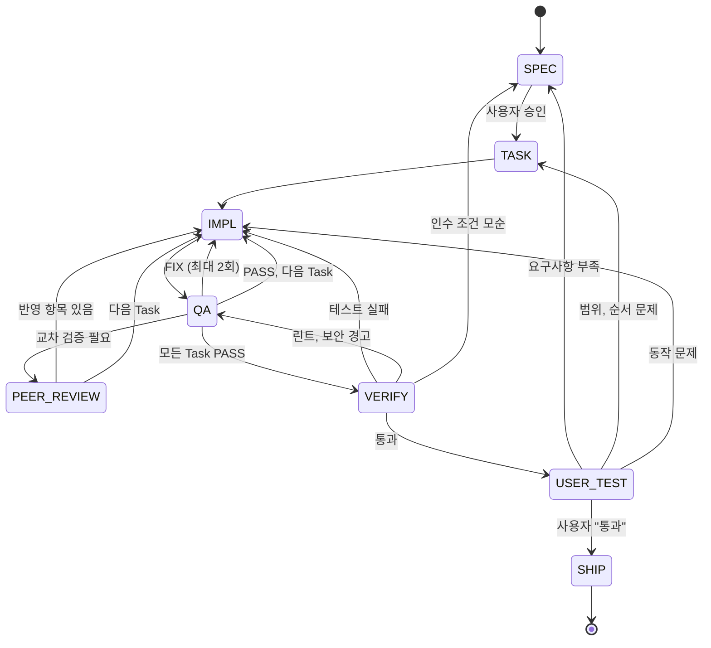
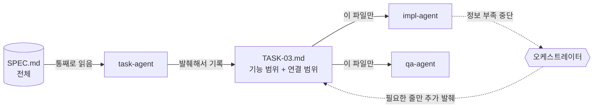

# 작업 흐름

## 전체 상태 흐름



## 단계 판별표

요청이 들어오면 오케스트레이터는 가장 먼저 이 표로 단계를 정하고 한 줄로 밝힙니다. 애매하면 더 앞 단계(Spec 쪽)로 분류합니다.

| 요청 내용 | 단계 |
|---|---|
| 새 기능, 화면, 흐름 추가 / 요구사항이 바뀜 / 정책이 애매함 | Spec |
| 기능은 정해졌는데 순서, 범위, 쪼개는 방식이 문제 | Task |
| 정해진 동작대로 안 됨 / 버그 / 테스트 실패 | Impl |
| 주석, 구조, 보안, 중복, 가독성 문제 | QA |
| 콘솔 에러, 린트 에러, E2E 실패, Sentry 이슈 | 자동 검증 → 원인에 따라 Impl 또는 QA |
| 사용자가 직접 써 보고 "부족하다"고 말함 | 사용자 최종 검증 → 위 기준으로 다시 분류 |

예시:

| 요청 | 판별 |
|---|---|
| "비밀번호 찾기도 넣어 줘" | `> 단계: Spec (새 흐름 추가)` |
| "로그인 Task가 너무 커, 나눠 줘" | `> 단계: Task (분해 단위 조정)` |
| "로그인 버튼 눌러도 반응이 없어" | `> 단계: Impl (정해진 동작 불일치)` |
| "이 함수 너무 길어" | `> 단계: QA (유지보수성)` |

## 단계별 상세

### Spec

- 담당: `spec-agent`
- 산출물: `docs/spec/SPEC.md`
- 목적, 사용자와 상황, 기능 목록(F-01, F-02 ...), 정상 흐름과 예외 흐름, 화면, API, 데이터 모델, 비기능 요구사항, 인수 조건, 범위 밖, 열린 질문, 변경 이력을 담습니다.
- 빈칸을 추측으로 채우지 않고 질문으로 돌려줍니다.
- **멈추는 지점**: 사용자 승인 전에는 Task로 넘어가지 않습니다.

### Task

- 담당: `task-agent`
- 산출물: `docs/tasks/TASK-XX-<이름>.md`, `docs/tasks/INDEX.md`
- 한 Task의 크기 기준: 바뀌는 파일 5개 이하, 테스트 케이스 3~8개, 인수 조건 하나에 대응
- 각 Task에 기능 범위(Spec 발췌), 연결 범위(계약), 범위와 범위 밖, 먼저 작성할 테스트, 완료 조건, 중단 조건, 실행 방식(병렬/순차)을 적습니다.
- "왜 이렇게 나눴나"를 한두 줄 붙여서, 처음 보는 사람도 전체에서 어떤 조각인지 알 수 있게 합니다.

### Impl (TDD)

- 담당: `impl-agent`
- 순서
  1. **Red**: 실패하는 테스트를 쓰고, 실행해서 실패하는 것을 확인합니다.
  2. **Green**: 통과시키는 가장 단순한 코드를 씁니다.
  3. **Refactor**: 통과 상태를 유지하며 정리합니다.
- 범위 밖 파일은 고치지 않습니다. 필요하면 `중단`으로 기록하고 멈춥니다.
- 새 환경 변수가 생기면 `.env.example`에 키 이름만 추가합니다.

### QA

- 담당: `qa-agent`
- 산출물: `docs/qa/QA-TASK-XX.md`, 바뀐 파일의 헤더/푸터 주석
- 보안: 입력 검증, XSS, 인증/인가, 시크릿 하드코딩, 로그의 민감 정보, 위험한 함수, 새 의존성
- 유지보수성: 중복, 50줄 넘는 함수, 모호한 이름, 죽은 코드, 테스트가 인수 조건을 실제로 검증하는지
- 판정
  - `PASS`: 다음 Task, 모두 끝났으면 자동 검증
  - `FIX`: 파일:라인 단위로 고칠 점을 적고 Impl로 회귀. 같은 Task에서 2회를 넘으면 멈추고 보고
  - `PEER_REVIEW`: [피어 리뷰](peer-review.md)로

헤더/푸터 주석 규칙은 `docs/conventions/file-header-footer.md`에 있습니다.

```ts
/**
 * [파일] 로그인 폼 입력 검증 훅
 * [Spec] F-02 로그인 / [Task] TASK-03
 * [의존] 없음
 */
// ...
/**
 * [QA] 2026-11-02 PASS
 * [보안] 클라이언트 검증만 함. 서버 검증은 TASK-04.
 * [유지보수] 규칙이 늘면 schema로 분리.
 */
```

### 자동 검증

- 담당: `verify-agent`
- 단위 테스트, 타입 검사, ESLint는 동시에 실행하고, 셋이 통과하면 Playwright를 실행합니다.
- Playwright는 콘솔 에러와 4xx/5xx 응답도 실패로 봅니다.
- Sentry MCP나 `sentry-cli`가 있으면 개발 환경의 새 이슈를 확인합니다.
- 실패하면 원인에 따라 Impl(동작), QA(린트, 보안), Spec(인수 조건 모순)으로 회귀합니다.

### 사용자 최종 검증

- 오케스트레이터가 로컬 서버를 띄우고, Spec 인수 조건에서 뽑은 체크리스트를 줍니다.
- 피드백은 `docs/feedback/FEEDBACK.md`에 기록되고, 단계 판별표로 분류되어 되돌아갑니다.
- **멈추는 지점**: "통과"라고 말하기 전에는 커밋으로 넘어가지 않습니다.

### Git 게이트

- `/ship`으로 진행합니다. 자세한 내용은 [Git 안전장치](git-safety.md).

## 사람이 개입하는 곳

`/run`은 아래에서만 멈추고, 나머지는 자동으로 넘어갑니다.

1. Spec 승인
2. 피어 리뷰에서 두 리뷰어 의견이 반대이거나, 리뷰어가 파일을 바꿨거나, 자동으로 돌릴 수단이 없을 때
3. 로컬 서버 최종 검증
4. 커밋 메시지 확인

그 밖에 같은 Task의 FIX가 2번을 넘거나, 에이전트가 중단 조건에 걸리면 멈추고 보고합니다.

## 산출물 한눈에 보기

| 파일 | 만드는 쪽 | 내용 |
|---|---|---|
| `docs/STATE.md` | 오케스트레이터 | 현재 상태, 대기 항목, Task 진행표, 회귀 기록 |
| `docs/status/AGENT_LOG.md` | 모든 작업 에이전트 | 시작, 완료, 중단 기록 |
| `docs/spec/SPEC.md` | spec-agent | 요구사항 전체 |
| `docs/tasks/INDEX.md` | task-agent | 순서, 의존, 실행 방식, 그룹 |
| `docs/tasks/TASK-XX-*.md` | task-agent | Task 지시서 |
| `docs/qa/QA-TASK-XX.md` | qa-agent | QA 보고와 판정 |
| `docs/review/REVIEW-TASK-XX.md` | 오케스트레이터 | 피어 리뷰 요청, 결과, 교차 검증, 반영 결정 |
| `docs/feedback/FEEDBACK.md` | 오케스트레이터 | 사용자 피드백과 분류 |

## 컨텍스트를 아끼는 방식

Spec은 Task 에이전트만 통째로 읽습니다. 구현하는 쪽에는 **그 기능에 해당하는 줄**과 **앞뒤 기능과 맞물리는 계약**만 내려갑니다.



### Task 파일의 두 칸

| 칸 | 담는 것 | 담지 않는 것 |
|---|---|---|
| 기능 범위 | 이 Task가 처리할 요구사항, 흐름 단계, 예외, 인수 조건, 쓰는 데이터 필드와 API 행 | 다른 기능, 배경 설명, 전체 데이터 모델 |
| 연결 범위 | 받아 쓰는 것과 내보내는 것의 계약 (시그니처, 타입, 요청/응답 형태) | 연결된 코드의 구현 내용, 파일 전체 |

연결 범위 예시:

```
### 받아 쓰는 것
| `TodoItem` | src/types/todo.ts | { id: string; title: string; dueDate?: string } |

### 내보내는 것
| `formatDueDate` | src/utils/date.ts | (iso: string) => string | TASK-04 |
```

선행 Task의 "내보내는 것"과 다음 Task의 "받아 쓰는 것"은 글자 그대로 같아야 합니다. QA는 계약이 바뀌었으면 FIX로 돌려보냅니다.

### 에이전트별로 넘기는 것

| 받는 쪽 | 넘기는 것 | 넘기지 않는 것 |
|---|---|---|
| `spec-agent` | 요청 원문, 기존 SPEC 경로 | 대화 기록 전체 |
| `task-agent` | SPEC 경로, 대상 기능 ID | 코드 |
| `impl-agent` | Task 파일 경로 하나, 검증 명령 | SPEC 경로, 다른 Task, 이전 대화 |
| `qa-agent` | Task 번호, 바뀐 파일 목록 | SPEC 경로 |
| `verify-agent` | 검증 명령 목록 | Spec, Task 내용 |

### 정보가 부족할 때

1. Impl은 Spec을 직접 찾아보지 않고 `중단`하며, 무엇이 부족한지 한 줄로 보고합니다.
2. 오케스트레이터가 SPEC에서 그 줄만 찾아 Task 파일 맨 아래 "추가 발췌"에 붙입니다. Spec에도 없으면 Spec 단계로 돌아가 사용자에게 묻습니다.
3. 같은 Task 파일로 Impl을 다시 실행합니다.
4. 한 Task에서 추가 발췌가 3번을 넘으면 Task를 잘못 나눈 것이므로 Task 단계로 돌아가 다시 나눕니다.

### Task 크기 신호

기능 범위와 연결 범위를 합쳐 60줄 정도를 넘으면, 한 번의 Impl에 넘기기에 큰 Task입니다. Task 에이전트가 더 쪼갭니다.
